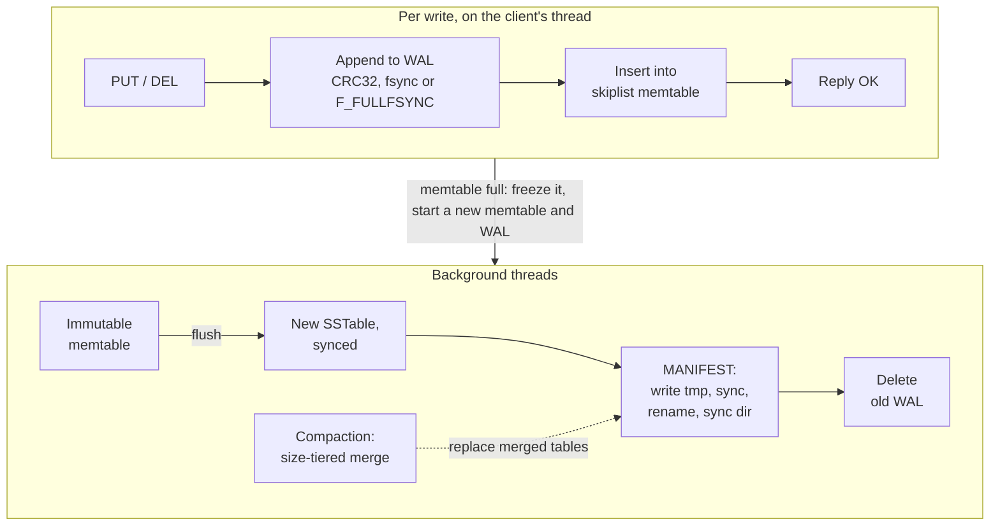
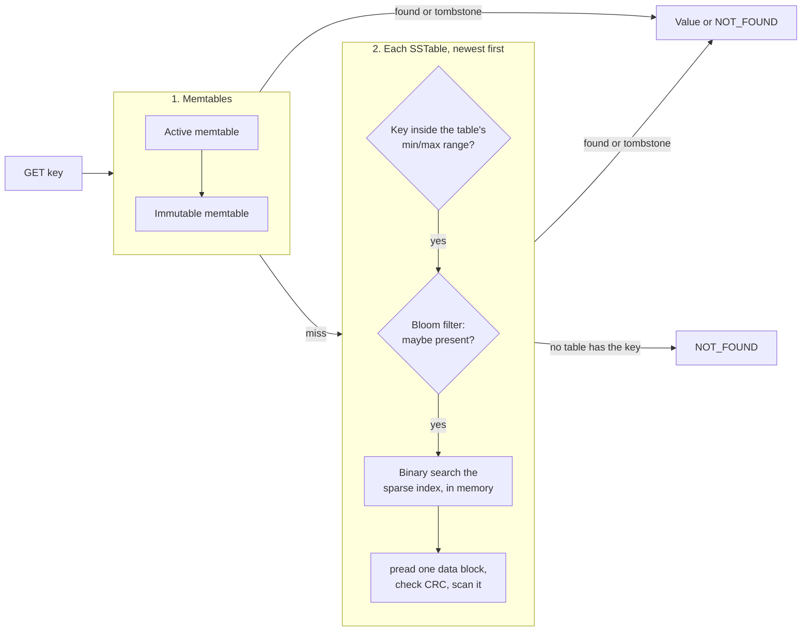
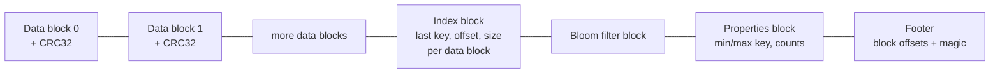

# lsm-kv-store

[](https://github.com/byteKumar/lsm-kv-store/actions/workflows/ci.yml)

A persistent key-value storage engine in C++20, built as a log-structured merge tree, with a write-ahead log, Bloom-filtered SSTables, background compaction and a small TCP server.

## Results at a glance

Measured on an Apple M3 (16 GB, internal SSD) with 10M keys (16 B keys, 100 B values), single thread. Each number is from one run. Full details and raw output: [RESULTS.md](RESULTS.md).

- **Writes:** 525,023 sequential and 394,026 random writes/s (WAL written, not fsynced per write).
- **Bloom filters:** missing-key reads go from 155,336/s to 3,565,132/s, and data blocks read per lookup drop from 4.0000 to 0.0324. Measured false-positive rate 0.809% vs 0.819% in theory (10 bits/key).
- **Write amplification:** 4.59 including the WAL (3.38 excluding it) after loading 10M keys.
- **Crash safety:** 100 `kill -9` crashes with `--sync full` (`F_FULLFSYNC` per write), 29,531 acknowledged puts, 0 lost.
- **Tests:** 89 GoogleTest tests passing in normal, ASan + UBSan + LeakSanitizer and TSan builds, on macOS and in CI on Linux.

## Architecture

### Write path



A write is acknowledged only after it is in the WAL (synced per `--sync`) and in the memtable. When the memtable is full it is frozen, a new memtable and WAL take over, and a background thread writes the frozen one to an SSTable. The old WAL is deleted only after the manifest that lists the new table is durable.

### Read path



A "no" from the range check or the Bloom filter, or a block that turns out not to hold the key (a false positive), moves on to the next table. The first version found wins, and a tombstone means the key is deleted. Range scans merge iterators over both memtables and every SSTable, and show only the newest version of each key visible at the scan's start.

### SSTable layout



Opening a table reads the footer, then keeps the index, Bloom filter and properties in memory. A point lookup reads at most one data block.

### Source files

| Path | What it does |
|---|---|
| [`src/skiplist.h`](src/skiplist.h), [`src/memtable.h`](src/memtable.h) | Skiplist memtable: one writer, lock-free readers |
| [`src/wal.h`](src/wal.h), [`src/crc32.cc`](src/crc32.cc) | Write-ahead log, torn-record recovery, CRC32 (ARMv8 instructions or a lookup table) |
| [`src/sstable.h`](src/sstable.h), [`src/bloom.h`](src/bloom.h) | SSTable writer and reader, block index, Bloom filters |
| [`src/db.h`](src/db.h) | The engine: write and read paths, flush and compaction threads, recovery, stats |
| [`src/manifest.h`](src/manifest.h) | Atomic manifest of live tables, file naming |
| [`src/merger.h`](src/merger.h) | Merging iterator and point-in-time user iterator |
| [`src/server.h`](src/server.h), [`tools/lsm_server.cc`](tools/lsm_server.cc) | TCP server and its text protocol |
| [`tools/lsm_bench.cc`](tools/lsm_bench.cc), [`scripts/crash_test.py`](scripts/crash_test.py) | Benchmark harness and `kill -9` crash test |
| [`tests/`](tests/) | GoogleTest suites |

## Approach

| Decision | Why | Trade-off |
|---|---|---|
| Skiplist memtable with lock-free reads | A new node is fully built, then linked in with a release store; readers use acquire loads. Gets and scans never take a lock, even while a write is running. | Nodes are never freed until the whole memtable is dropped, and every write adds a new versioned entry instead of overwriting, so a memtable holds old versions until it is flushed. |
| Sequence number on every entry | Newest version wins by sequence number, and an iterator can ignore writes made after it was created (point-in-time scans). | Extra bytes per entry on disk; flush and compaction drop the older versions. |
| Size-tiered compaction on its own thread | Merging runs of adjacent, similar-size tables rewrites data fewer times than leveled compaction, which keeps write amplification low. A separate thread means a long merge never blocks a flush. | More tables can overlap a key, so a lookup may check several. A merge temporarily needs space for its inputs and output. Tombstones are dropped only when the merge includes the oldest table. When too many tables pile up, writers wait, and compaction then merges the cheapest group of adjacent tables even if their sizes differ. |
| `F_FULLFSYNC` per write, then a strict file order | On macOS a plain `fsync` does not wait for the drive to flush its cache; `F_FULLFSYNC` does. New tables and the manifest are synced, and the manifest is replaced by rename, before the old WAL is deleted. | Durable writes are slow (336 writes/s), because there is no group commit: each write waits for its own flush. |
| Sparse index and Bloom filter per table, kept in memory | A point lookup costs at most one data block read, and the filter skips most tables that don't hold the key. | Index and filter memory grows with the number of keys. |
| No block cache | Every block read is a counted `pread`, so "blocks read per lookup" is exact. | Read speed depends on the OS file cache (see Limitations). |
| No compression | Simpler format; benchmark numbers are easier to explain. | Uses more disk and I/O than compressed blocks would. |

**Benchmark method.** `lsm_bench` runs every workload once, single-threaded, and prints the engine's own counters. Loaded keys are even numbers; missing keys are the odd numbers between them, so they fall inside every table's key range and only the Bloom filter can skip them. The Bloom off and on runs use the same files, reopened with filters ignored or used. The load benchmarks use WAL sync `none` (`write(2)` per record, no fsync); a separate workload measures what each sync mode costs per write. Before each timed run, the machine was checked for other benchmarks or load tests.

**Crash-test method.** `crash_test.py` runs 4 client connections that write keys and delete every 10th one. A write counts as acknowledged only when `OK` arrives. After a random 0.3-1.5 s the server gets SIGKILL. It is restarted, and every key with a known outcome is checked: acknowledged puts must return the exact value, and acknowledged deletes must be NOT_FOUND. Writes in flight at the kill are not judged.

## Results

Apple M3, 8 cores (4 performance + 4 efficiency), 16 GB RAM, internal Apple SSD (APFS), macOS 26.6.2. Raw output is in [`bench/results/`](bench/results/).

### Throughput: 10M keys, 16 B keys, 100 B values

Single thread, WAL sync `none`, 64 MB memtable, 4 KB blocks, 10 bits/key Bloom filters, compaction on.

| Workload | Result |
|---|---|
| Sequential writes (fresh DB) | 525,023 writes/s |
| Random-order writes (fresh DB) | 394,026 writes/s |
| Random reads, existing keys (1M) | 111,419 reads/s, first pass after reopen, mostly cold cache |
| Random reads, existing keys, warm cache (separate diagnostic run, passes 2 and 3) | 503,412 and 508,281 reads/s |
| Random reads, missing keys (1M, Bloom on) | 3,565,132 reads/s |
| Range scan of 1,000 keys (10,000 scans) | p50 0.112 ms, p99 0.127 ms |

### Bloom filter (10 bits per key)

| | Bloom off | Bloom on |
|---|---|---|
| Missing-key reads/s | 155,336 | 3,565,132 (23.0× faster) |
| Data blocks read per lookup | 4.0000 | 0.0324 (124× fewer) |
| False-positive rate | | 0.809% measured, 0.819% theory |

### Write amplification after loading 10M keys

| Load | Including WAL | Excluding WAL |
|---|---|---|
| Sequential | 4.59 | 3.38 |
| Random order | 4.59 | 3.38 |

### Cost of durability per write

| WAL sync mode | writes/s | p50 latency | p99 latency |
|---|---|---|---|
| `none` (write only) | 548,434 | 1.5 µs | 4.5 µs |
| `fsync` | 48,031 | 17.8 µs | 48.5 µs |
| `full` (`F_FULLFSYNC`) | 336 | 3.0 ms | 4.1 ms |

### Crash test (`kill -9`)

| Run | Kills | Acked puts | Acked deletes | Lost acked writes | Deletes undone | Wrong values | Recovery p50 / max |
|---|---|---|---|---|---|---|---|
| `--sync full`, 256 KB memtable | 100 | 29,531 | 2,925 | 0 | 0 | 0 | 24 / 32 ms |
| `--sync full`, 16 KB memtable | 100 | 29,615 | 2,930 | 0 | 0 | 0 | 24 / 31 ms |
| `--sync full`, 16 KB memtable, instrumented | 100 | 29,464 | 2,918 | 0 | 0 | 0 | 23 / 33 ms |
| `--sync none`, 16 KB memtable | 20 | 814,378 | 81,422 | 0 | 0 | 0 | 4 / 6 ms |

## How to run

Needs CMake and a C++20 compiler. GoogleTest is downloaded by CMake.

```bash
cmake -S . -B build -DCMAKE_BUILD_TYPE=Release && cmake --build build -j8
```

Start the server and talk to it:

```bash
./build/lsm_server --dir /tmp/lsm-demo --port 7070 --sync full
```

```text
$ nc localhost 7070
PUT city boston
OK
GET city
VALUE boston
SCAN "" 10
city boston
END
DEL city
OK
```

Commands: `PUT <key> <value>`, `GET <key>`, `DEL <key>`, `SCAN <start> <count>`, `PING`, `STATS`, `QUIT`. `OK` is sent only after the write is in the WAL and synced per `--sync` (`none`, `fsync` or `full`). The server listens on 127.0.0.1 unless `--host` is given.

Run the benchmark (needs about 3 GB of free disk at its peak; it deletes its data when done):

```bash
./build/lsm_bench --dir bench-data
```

Run the crash test:

```bash
python3 scripts/crash_test.py --server build/lsm_server --dir /tmp/lsm-crash --kills 100 --sync full
```

## Tests and CI

All 89 tests, in three builds (normal, ASan + UBSan + LeakSanitizer, TSan):

```bash
./scripts/test_all.sh
```

On macOS 26.6 the ASan and TSan runtimes that ship with Apple clang 17 crash at startup, even for hello-world, so the sanitizer builds use Homebrew LLVM (`brew install llvm`). Override with `SAN_CXX=...`.

[GitHub Actions](.github/workflows/ci.yml) builds and runs all 89 tests on every push: Ubuntu 24.04 with clang 18 in Release, ASan + UBSan + LeakSanitizer and TSan builds, and macOS in a Release build. The Linux Release job also runs a short benchmark and a 5-kill crash test. First green run: [43928530386](https://github.com/byteKumar/lsm-kv-store/actions/runs/43928530386).

The sanitizers reported no issues in project code. The tests caught two real bugs, both fixed and covered by tests:

- **Write-stall deadlock.** Writers wait when there are too many tables, but tables whose sizes each differ by about 2× never formed a size-tiered run, so writers waited forever. Fix: at the stall limit, compaction merges the cheapest group of adjacent tables.
- **Skewed read counters.** Compaction's block reads were counted as lookup block reads. They are now counted separately.

## Limitations

- **Single runs.** Every benchmark number comes from one run on one machine.
- **Hit reads depend on the OS cache.** The 111,419 reads/s figure is a first pass, mostly from the SSD. A separate run measured 69,966 reads/s on its first pass and about 505k reads/s once the data was cached. There is no block cache.
- **`kill -9` is not power loss.** The crash test kills the process, not the machine, so data already passed to `write(2)` survives even without fsync (the `--sync none` run also lost 0). Power-loss durability rests on the design (`F_FULLFSYNC` per write and the sync order above) and is not measured.
- **Few kills landed during background work.** In the instrumented run, 15 of 100 kills landed during a flush and only 1 during a compaction.
- **No group commit.** With `--sync full`, durable throughput is 336 writes/s because each write waits for its own flush.
- **Size-tiered only.** Leveled compaction is not implemented.
- **Benchmarks are single-threaded** and use uncompressed blocks.
- **Simple server.** The text protocol has no authentication, keys cannot contain spaces, and values cannot contain newlines. The server uses one thread per connection.
- **Linux durability differs.** Linux has no `F_FULLFSYNC`, so `--sync full` uses plain `fsync` there, which does flush the drive cache. The benchmark numbers above are from macOS only.
